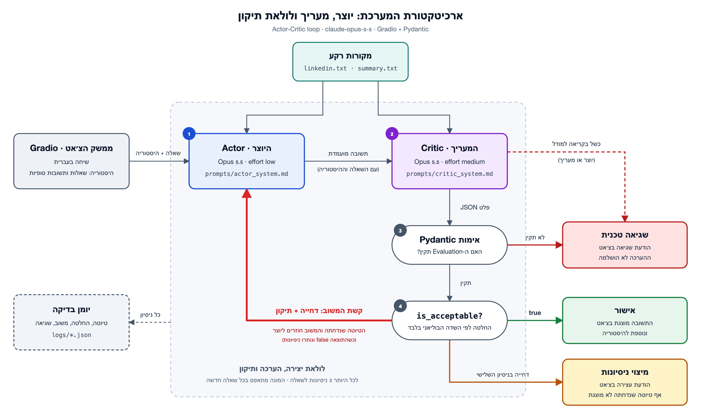
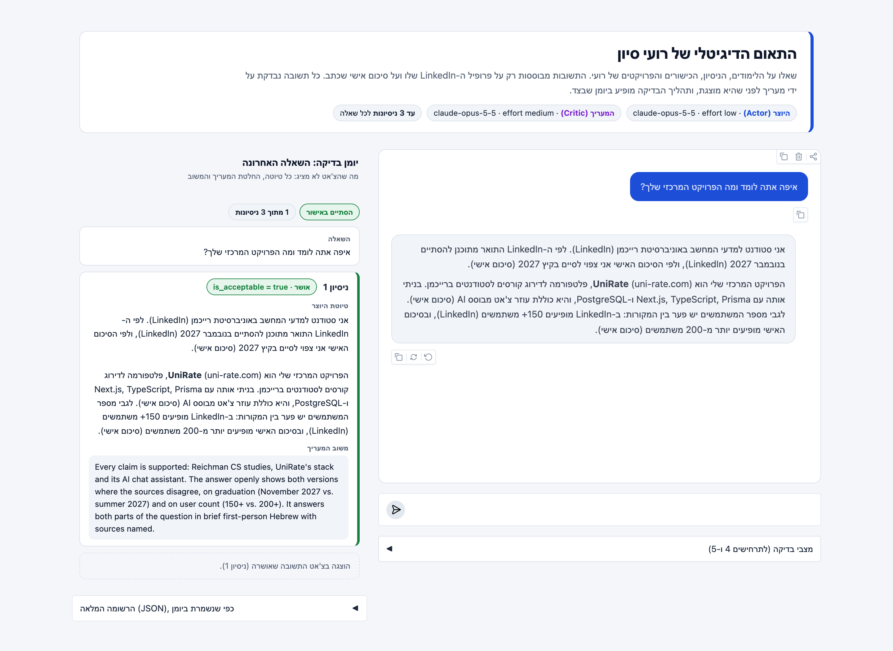
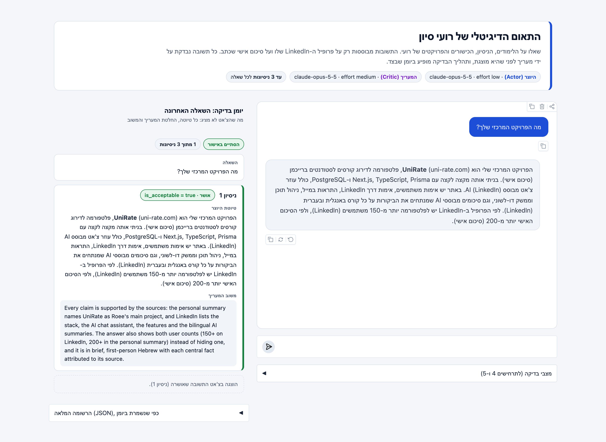
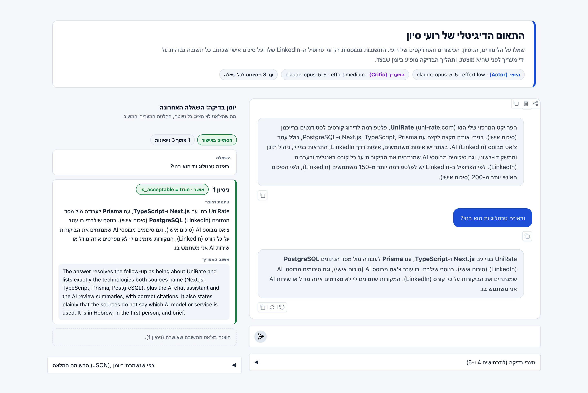
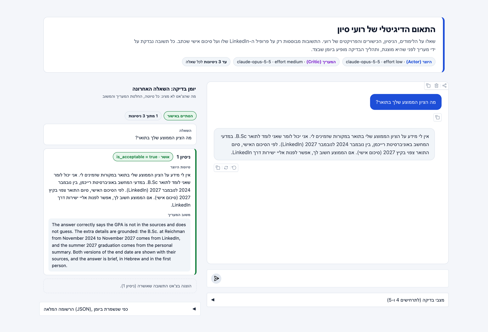
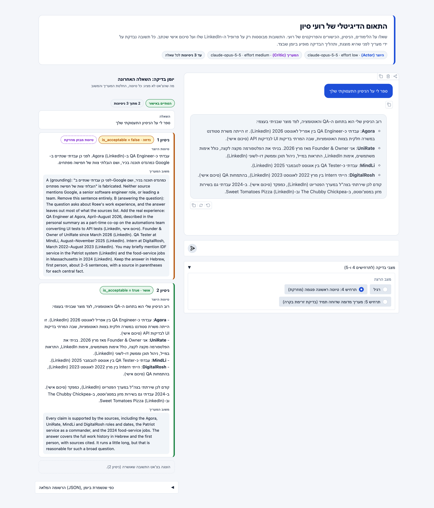
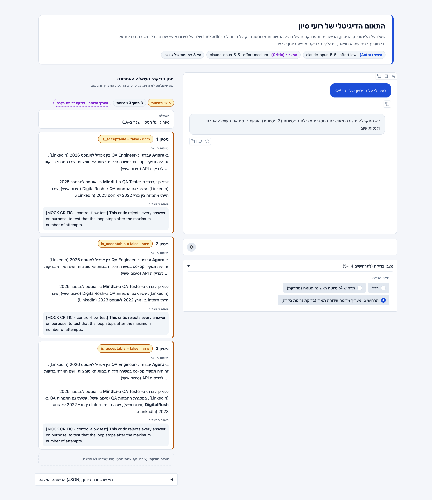

# צ'אט אישי עם מעריך תשובות ולולאת שיפור

**מטלה 1, מערכות בינה מלאכותית** · מרצה: ד"ר פאול אברהמי · מגיש: רועי סיון

קוד, יומנים וצילומי מסך: <https://github.com/RoeeSivan/digital_twin>

## 1. המערכת בקצרה

היישום הוא צ'אט בעברית ב-Gradio שעונה על שאלות עליי. מידע הרקע מגיע משני קבצים: `data/linkedin.txt` (ייצוא של פרופיל ה-LinkedIn) ו-`data/summary.txt` (סיכום אישי). התהליך כתוב בקוד Python ישיר, בלי ספריית סוכנים.

לכל שאלה היוצר (Actor) כותב טיוטה, והמעריך (Critic) בודק אותה מול ארבעה קריטריונים: ביסוס במקורות, מענה לשאלה, טיפול במידע חסר ובהירות. המעריך מחזיר JSON, והיישום מאמת אותו מול מודל ה-Pydantic בשם `Evaluation` (`is_acceptable: bool`, `feedback: str`). הלולאה מחליטה רק לפי השדה הבוליאני, ורק אחרי שהאימות עבר. יש שלוש יציאות:

| מצב סיום | מתי | מה המשתמש רואה |
|---|---|---|
| `approved` | המעריך אישר את אחת הטיוטות | הטיוטה שאושרה |
| `exhausted` | שלושה ניסיונות נדחו | הודעת עצירה, ואף טיוטה שנדחתה |
| `error` | קריאה למודל נכשלה, או שפלט המעריך לא עבר אימות | הודעת שגיאה, והטיפול בשאלה נעצר |

שני התפקידים רצים על `claude-opus-5-5`, בקריאות נפרדות ועם הנחיות נפרדות (`prompts/actor_system.md`, `prompts/critic_system.md`). היוצר רץ ב-effort `low` והמעריך ב-effort `medium`. הצ'אט מציג רק את שאלות המשתמש ואת התשובות הסופיות. הטיוטות, ההחלטות והמשוב נשמרים ביומן בדיקה בפורמט JSON ומוצגים בלוח נפרד לצד הצ'אט. תרשים הארכיטקטורה מופיע בתרשים 1, אחרי גוף הדוח.

## 2. כיצד המשוב שינה תשובה

בתרחיש 4 הטיוטה הראשונה לא נכתבה על ידי היוצר. היא הוזנה כטיוטת מבחן עם משפט אחד נכון ומשפט אחד מומצא. השאלה הייתה "ספר לי על הניסיון התעסוקתי שלך".

| ניסיון | טיוטה | החלטת המעריך |
|---|---|---|
| 1 (מוזרקת) | "עבדתי כ-QA Engineer ב-Agora (LinkedIn). לפני כן עבדתי שנתיים ב-Google כמהנדס תוכנה בכיר, ושם הובלתי צוות של חמישה מפתחים." | `false` |
| 2 (היוצר) | Agora כמשרת co-op חלקית בין אפריל לאוגוסט 2026, MindLi, DigitalRosh, השירות במערך ה-Patriot ו-UniRate, עם ציון המקור ליד כל פרט | `true` |

המשוב על ניסיון 1 ציטט את המשפט המומצא, קבע ש"אף מקור לא מזכיר את Google, תפקיד בכיר או הובלת צוות", והורה להסיר אותו. בנוסף הוא ציין שהתשובה משמיטה כמעט את כל הניסיון האמיתי, ופירט אילו תפקידים ותאריכים מופיעים במקורות.

המשוב שינה את התשובה בשלוש דרכים:

1. **ההמצאה נעלמה.** Google, "מהנדס בכיר" ו"צוות של חמישה" לא מופיעים בגרסה השנייה.
2. **החלק הנכון נשמר.** המשפט על Agora נשאר. המעריך הצביע על המשפט הבעייתי, ולא פסל את כל הטיוטה.
3. **החסר הושלם.** התפקידים שהמעריך מנה נכנסו לתשובה, עם התאריכים מהמקורות.

מבחינת הקוד, בניסיון חוזר היוצר מקבל באותה פנייה את השאלה, את הטיוטה שנדחתה ואת המשוב (הפונקציה `revision_request` ב-`src/twin/actor.py`). בלי שני אלה הוא היה כותב תשובה חדשה בלי לדעת מה היה שגוי בקודמת.

המשוב עבד גם בלי הזרקה. בתרחיש 1 היוצר כתב שהתואר יסתיים "בקיץ 2027", לפי הסיכום האישי. ב-LinkedIn התואר רשום עד נובמבר 2027. המעריך דחה, כי התשובה הציגה גרסה אחת כאילו היא היחידה, והיוצר הסיר את התאריך בניסיון השני.

## 3. מדוע תקינות הסכמה אינה מבטיחה תשובה נכונה

Pydantic רואה רק את הפלט של המעריך. הוא לא רואה את התשובה של היוצר ולא את המקורות. לכן הוא יכול לבדוק רק מבנה: שיש שדה בוליאני אמיתי, שיש שדה טקסט לא ריק, ושאין שדות נוספים.

| פלט המעריך | אימות Pydantic | מה קורה בלולאה |
|---|---|---|
| `{"is_acceptable": "true", ...}` (מחרוזת, לא בוליאני) | נכשל | `error`, לא אישור |
| `{"is_acceptable": true}` (בלי `feedback`) | נכשל | `error`, לא אישור |
| `{"is_acceptable": true, "feedback": "All claims are supported."}` על תשובה עם ההמצאה על Google | **עובר** | `approved`, והטעות מוצגת למשתמש |

השורה השלישית היא הבעיה. המבנה תקין, ההחלטה שגויה, ושום דבר בקוד לא מבחין בכך. האימות מבטיח שהערך שעליו הלולאה מחליטה הוא באמת `true` או `false`. הוא לא מבטיח שה-`true` מוצדק.

מכאן שתי החלטות במימוש. הראשונה: כשל באימות מסיים את הטיפול בשאלה במצב `error` ולעולם לא נחשב אישור. הסכמה מוגדרת `strict`, כך שגם המחרוזת `"true"` נכשלת במקום להפוך בשקט לאישור. הבדיקות ב-`tests/test_critic.py` וב-`tests/test_loop.py` מכסות את המקרים האלה. השנייה: את נכונות ההחלטות עצמן בדקתי ידנית, כמתואר בסעיף הבא.

## 4. מגבלה של המעריך שזוהתה בבדיקה הידנית

בדקתי שלוש תשובות שהמעריך אישר, טענה אחר טענה מול שני קובצי הרקע (`results/manual_check.md`). מתוך 19 טענות, 16 נתמכות במלואן, 3 נתמכות חלקית, ואף אחת לא הומצאה.

**המגבלה המרכזית: המעריך תופס המצאה בוטה, אבל מאשר תוספת שנשמעת הגיונית.** בתרחיש 2 היוצר כתב "לשכבת הנתונים אני משתמש ב-Prisma וב-PostgreSQL". המקורות מזכירים את שתי הטכנולוגיות ברשימה, ואף מקור לא אומר מה התפקיד של כל אחת. "שכבת הנתונים" הוא ידע כללי של המודל. המעריך אישר בלי להעיר.

כאן התוספת נכונה טכנית ולא מזיקה. הבעיה היא במנגנון: המעריך הוא מודל שפה שמשלים פערים מהידע שלו, בדיוק כמו היוצר. במימוש שלי שניהם אותו מודל, ולכן מה שנראה ליוצר מובן מאליו נראה מובן מאליו גם למעריך. באותה דרך יכולה לעבור גם תוספת הגיונית שאינה נכונה.

שתי תצפיות נוספות מאותה בדיקה:

- **שלמות התשובה נשפטת באופן רופף.** בתרחיש 4 אושרה תשובה שהשמיטה שתי עבודות שמופיעות ב-LinkedIn. בהרצה אחרת של אותה שאלה היוצר כלל אותן, וגם התשובה הזו אושרה. ערך בוליאני אחד לא מבחין בין השתיים.
- **אותו קלט לא מוביל תמיד לאותו מסלול.** בתרחיש 1 נדרשו שני ניסיונות בהרצת הסקריפט וניסיון אחד בהרצה דרך הממשק. תוצאה של הרצה אחת היא דוגמה, לא הוכחה.

המסקנה: המעריך מוריד את הסיכון להמצאות, אבל הוא לא בדיקה דטרמיניסטית מול המקורות. שיפורים אפשריים: מודל אחר בתפקיד המעריך, דרישה שהמעריך יצטט את השורה במקור שתומכת בכל טענה, ובדיקה בקוד של שמות, תאריכים ומספרים מול קובצי הרקע.

## תרשים 1: ארכיטקטורת המערכת

התרשים מציג את מקורות הרקע, את ממשק הצ'אט וההיסטוריה, את היוצר, את המעריך ואת תוצאת ההערכה. קשת המשוב חוזרת מהמעריך ליוצר עם הטיוטה שנדחתה והמשוב. שלושת מסלולי היציאה הם אישור, מיצוי ניסיונות ושגיאה.

## נספח: תוצאות חמשת התרחישים

הפירוט המלא של כל תרחיש (קלט, כל הניסיונות, המשוב והפלט שהוצג) נמצא ב-`results/scenarios.md`. היומנים הגולמיים נמצאים ב-`logs/scenario_1.json` עד `logs/scenario_5.json`.

**תוצאות שהתקבלו ממודל שפה (מעריך אמיתי)**

| # | תרחיש | קלט | ניסיונות | מצב סיום | תאם את הציפייה |
|---|---|---|---|---|---|
| 1 | שאלה על מידע קיים | איפה אתה לומד ומה הפרויקט המרכזי שלך? | 2 | אישור | כן |
| 2 | שאלת המשך | מה הפרויקט המרכזי שלך? ואחריה: ובאיזה טכנולוגיות הוא בנוי? | 1 + 1 | אישור | כן |
| 3 | פרט שאינו במקורות | מה הציון הממוצע שלך בתואר? | 1 | אישור | כן |
| 4 | דחייה ושיפור | ספר לי על הניסיון התעסוקתי שלך | 2 | אישור | כן |

**תוצאה של בדיקה מדומה (בדיקת זרימת בקרה)**

| # | תרחיש | קלט | ניסיונות | מצב סיום | תאם את הציפייה |
|---|---|---|---|---|---|
| 5 | מיצוי הניסיונות | ספר לי על הניסיון שלך ב-QA | 3 | מיצוי ניסיונות | כן |

בתרחיש 5 המעריך הוא `FakeRejectCritic`, רכיב מדומה שדוחה כל תשובה בלי לקרוא למודל שפה. התרחיש בודק רק שהלולאה נעצרת אחרי הניסיון השלישי ושאף טיוטה שנדחתה לא מוצגת. הוא לא אומר דבר על איכות ההערכה.

צילומי המסך נמצאים ב-`results/screenshots/`. הם צולמו בהרצה נפרדת של אותם קלטים דרך הממשק (היומן שלה: `logs/session_screenshots.json`), ולכן הניסוח בהם יכול להיות שונה מעט מהניסוח שביומני התרחישים. בכל צילום הצ'אט מופיע מימין ולוח הבדיקה משמאל.

**צילום 1: תרחיש 1, שאלה על מידע קיים.**

**צילום 2: תרחיש 2, השאלה הראשונה.**

**צילום 3: תרחיש 2, שאלת ההמשך.** המילה "הוא" מפוענחת מתוך היסטוריית השיחה.

**צילום 4: תרחיש 3, פרט שאינו במקורות.**

**צילום 5: תרחיש 4, דחייה ושיפור.** ניסיון 1 (הטיוטה המוזרקת) נדחה, ניסיון 2 אושר. בצ'אט מוצגת רק התשובה שאושרה.

**צילום 6: תרחיש 5, מיצוי הניסיונות.** שלושה ניסיונות נדחו על ידי המעריך המדומה. בצ'אט מוצגת הודעת העצירה ולא אחת הטיוטות.

