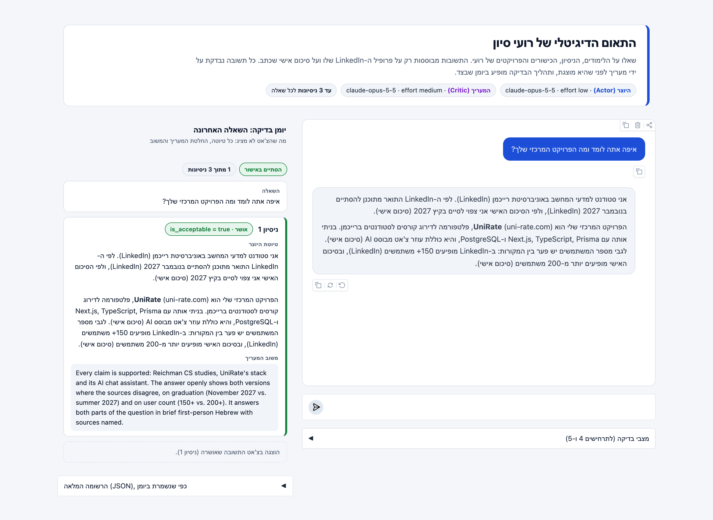
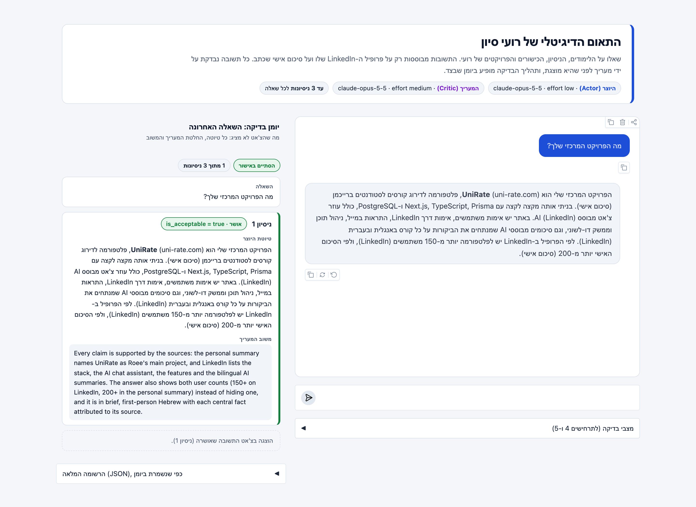
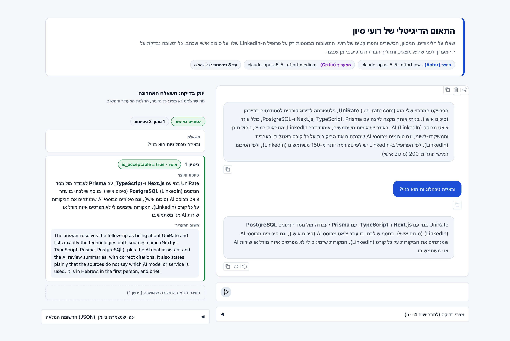
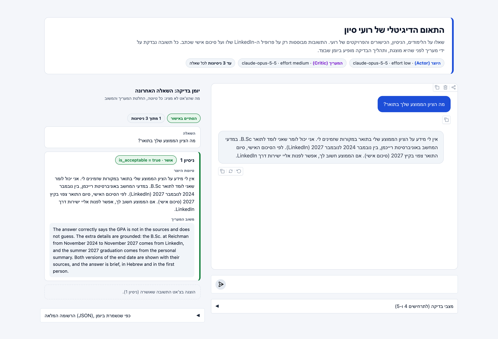
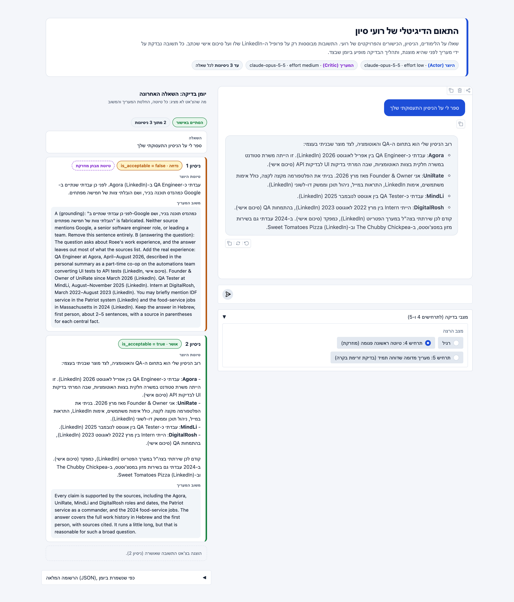
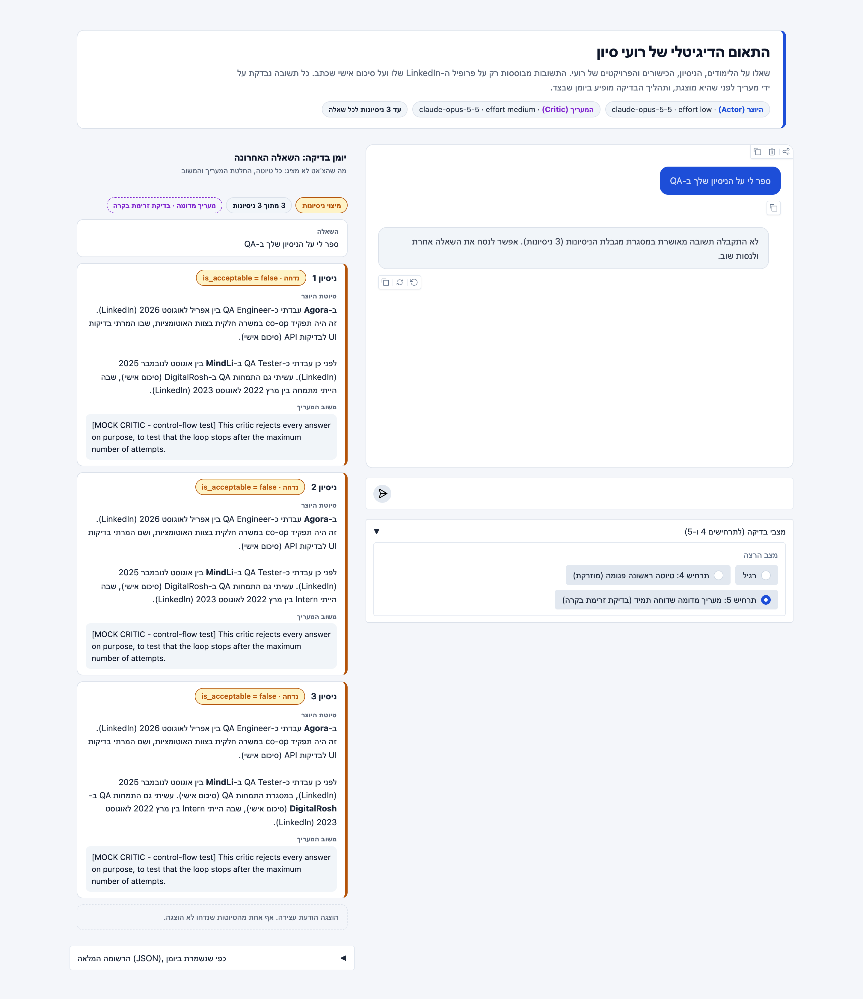

# תוצאות חמשת התרחישים (חלק ד)

המסמך נוצר אוטומטית על ידי `scripts/run_scenarios.py` מתוך היומנים שב-`logs/`. לכל תרחיש מופיעים הקלט, יומן הניסיונות, הפלט שהוצג למשתמש, והשוואה בין הציפייה להתנהגות בפועל.

- **היוצר (Actor):** `claude-opus-5-5`, effort `low`
- **המעריך (Critic):** `claude-opus-5-5`, effort `medium`
- **מגבלת ניסיונות:** 3 לכל שאלה, כולל התשובה הראשונה
- **מועד ההרצה:** 2026-11-15T15:56:27+02:00

הבדיקות האוטומטיות בודקות את זרימת הבקרה וסימנים פשוטים בטקסט. הן לא מוכיחות שהתוכן נכון. בדיקה ידנית של הטענות מול המקורות מופיעה ב-[`manual_check.md`](manual_check.md).

צילומי המסך צולמו בהרצה נפרדת של אותם קלטים דרך ממשק הצ'אט, ולכן ניסוח התשובות בהם יכול להיות שונה מעט מהניסוח שביומני התרחישים. היומן של הרצת הצילומים שמור ב-[`logs/session_screenshots.json`](../logs/session_screenshots.json).

## סיכום

### תוצאות שהתקבלו ממודל שפה (תרחישים 1 עד 4, מעריך אמיתי)

| # | תרחיש | קלט | ניסיונות | מצב סיום | תאם את הציפייה |
|---|---|---|---|---|---|
| 1 | שאלה על מידע קיים | איפה אתה לומד ומה הפרויקט המרכזי שלך? | 2 | אישור | כן |
| 2 | שאלת המשך | מה הפרויקט המרכזי שלך? / ובאיזה טכנולוגיות הוא בנוי? | 1 + 1 | אישור | כן |
| 3 | פרט שאינו במקורות | מה הציון הממוצע שלך בתואר? | 1 | אישור | כן |
| 4 | דחייה ושיפור | ספר לי על הניסיון התעסוקתי שלך | 2 | אישור | כן |

### תוצאות של בדיקה מדומה (תרחיש 5, בדיקת זרימת בקרה)

בתרחיש זה המעריך הוא `FakeRejectCritic`: רכיב מדומה שמחזיר דחייה בכל ניסיון ולא קורא למודל שפה. הטיוטות עצמן נכתבו על ידי היוצר האמיתי. התרחיש בודק רק שהלולאה נעצרת אחרי הניסיון השלישי. הוא לא אומר דבר על איכות ההערכה.

| # | תרחיש | קלט | ניסיונות | מצב סיום | תאם את הציפייה |
|---|---|---|---|---|---|
| 5 | מיצוי הניסיונות (בדיקת זרימת בקרה, מעריך מדומה) | ספר לי על הניסיון שלך ב-QA | 3 | מיצוי ניסיונות | כן |

## פירוט: תרחישים עם מעריך אמיתי (מודל שפה)

### תרחיש 1: שאלה על מידע קיים

**ציפייה:** תשובה מאושרת שמבוססת על המקורות (אוניברסיטת רייכמן, UniRate) ומפנה למקור התומך.

**קלט:** איפה אתה לומד ומה הפרויקט המרכזי שלך?

| ניסיון | מקור הטיוטה | החלטת המעריך | משוב המעריך |
|---|---|---|---|
| 1 | היוצר | נדחה (`false`) | A: "וצפוי לסיים בקיץ 2027 (סיכום אישי)" gives one graduation date as the only truth. The sources disagree. The personal summary says summer 2027, but LinkedIn lists the degree as November 2024 – November 2027. Either drop the graduation date, since the question did not ask for it, or state both versions the same way you already did for the user count. Everything else is supported and fine. Reichman B.Sc. in CS, UniRate, its tech stack and AI chat assistant all appear in the sources, and the 150+/200+ conflict is handled correctly. The answer also meets B and D. |
| 2 | היוצר | אושר (`true`) | Every claim is supported: the B.Sc. in Computer Science at Reichman University, UniRate's tech stack and AI chat assistant all appear in LinkedIn, and the answer openly presents both user counts (150+ in LinkedIn, 200+ in the personal summary) instead of picking one. It answers both parts of the question in brief first-person Hebrew with sources named in parentheses; the bold formatting is only a minor style choice. |

טיוטה 1:

> לומד מדעי המחשב (B.Sc.) ב-**Reichman University** (LinkedIn), וצפוי לסיים בקיץ 2027 (סיכום אישי). הפרויקט המרכזי שלי הוא **UniRate** (uni-rate.com), פלטפורמה לדירוג קורסים לסטודנטים ב-Reichman. בניתי אותה עם Next.js, TypeScript, Prisma ו-PostgreSQL, והיא כוללת עוזר צ'אט מבוסס AI (LinkedIn). לגבי מספר המשתמשים יש פער בין המקורות: לפי LinkedIn יש בה יותר מ-150 משתמשים, ולפי הסיכום האישי יותר מ-200 (סיכום אישי).

טיוטה 2:

> אני לומד לתואר B.Sc. במדעי המחשב ב-**Reichman University** (LinkedIn). הפרויקט המרכזי שלי הוא **UniRate** (uni-rate.com), פלטפורמה לדירוג קורסים לסטודנטים ב-Reichman. בניתי אותה עם Next.js, TypeScript, Prisma ו-PostgreSQL, והיא כוללת עוזר צ'אט מבוסס AI (LinkedIn). לגבי מספר המשתמשים יש פער בין המקורות: לפי LinkedIn יש בה יותר מ-150 משתמשים (LinkedIn), ולפי הסיכום האישי יותר מ-200 (סיכום אישי).

**הפלט שהוצג למשתמש** (מצב סיום: אישור, `approved`):

> אני לומד לתואר B.Sc. במדעי המחשב ב-**Reichman University** (LinkedIn). הפרויקט המרכזי שלי הוא **UniRate** (uni-rate.com), פלטפורמה לדירוג קורסים לסטודנטים ב-Reichman. בניתי אותה עם Next.js, TypeScript, Prisma ו-PostgreSQL, והיא כוללת עוזר צ'אט מבוסס AI (LinkedIn). לגבי מספר המשתמשים יש פער בין המקורות: לפי LinkedIn יש בה יותר מ-150 משתמשים (LinkedIn), ולפי הסיכום האישי יותר מ-200 (סיכום אישי).

**בדיקות אוטומטיות:**

- ✅ הסתיים באישור
- ✅ התשובה מזכירה את רייכמן ואת UniRate
- ✅ התשובה מפנה למקור: (LinkedIn) או (סיכום אישי)

**האם ההתנהגות בפועל תאמה את הציפייה:** כן

יומן מלא: [`logs/scenario_1.json`](../logs/scenario_1.json)

צילומי מסך (הרצה נפרדת של אותו קלט בממשק, ראו הערה בראש המסמך):

### תרחיש 2: שאלת המשך

**ציפייה:** בפנייה השנייה המילה "הוא" מפוענחת כ-UniRate מתוך התשובה הקודמת, והתשובה מפרטת את הטכנולוגיות שלו (Next.js, TypeScript, Prisma, PostgreSQL).

**פנייה 1:** מה הפרויקט המרכזי שלך?

| ניסיון | מקור הטיוטה | החלטת המעריך | משוב המעריך |
|---|---|---|---|
| 1 | היוצר | אושר (`true`) | Every claim is supported by the sources: UniRate as the main project, its tech stack, the AI chat, the end-to-end features and the bilingual AI summaries. The answer also shows both user counts (150+ on LinkedIn, more than 200 in the personal summary) rather than hiding the conflict. It is in Hebrew, first person, concise, and names the source of each central fact. |

טיוטה 1:

> הפרויקט המרכזי שלי הוא **UniRate** (uni-rate.com), פלטפורמה לדירוג קורסים לסטודנטים ברייכמן (סיכום אישי). בניתי אותה עם Next.js, TypeScript, Prisma ו-PostgreSQL, וכללתי בה צ'אט AI (LinkedIn). הפיתוח היה מקצה לקצה: אימות משתמשים, אימות דרך LinkedIn, התראות במייל, ניהול תוכן, ממשק דו-לשוני וסיכומי ביקורות מבוססי AI באנגלית ובעברית (LinkedIn). לגבי מספר המשתמשים, בפרופיל ה-LinkedIn מופיע 150+ (LinkedIn), ובסיכום האישי מופיע יותר מ-200 (סיכום אישי).

**הפלט שהוצג למשתמש** (מצב סיום: אישור, `approved`):

> הפרויקט המרכזי שלי הוא **UniRate** (uni-rate.com), פלטפורמה לדירוג קורסים לסטודנטים ברייכמן (סיכום אישי). בניתי אותה עם Next.js, TypeScript, Prisma ו-PostgreSQL, וכללתי בה צ'אט AI (LinkedIn). הפיתוח היה מקצה לקצה: אימות משתמשים, אימות דרך LinkedIn, התראות במייל, ניהול תוכן, ממשק דו-לשוני וסיכומי ביקורות מבוססי AI באנגלית ובעברית (LinkedIn). לגבי מספר המשתמשים, בפרופיל ה-LinkedIn מופיע 150+ (LinkedIn), ובסיכום האישי מופיע יותר מ-200 (סיכום אישי).

**פנייה 2:** ובאיזה טכנולוגיות הוא בנוי?

| ניסיון | מקור הטיוטה | החלטת המעריך | משוב המעריך |
|---|---|---|---|
| 1 | היוצר | אושר (`true`) | The answer correctly resolves 'it' to UniRate. It lists Next.js, TypeScript, Prisma and PostgreSQL, the live AI chat and the bilingual AI review summaries, all of which the sources support and cite. It also states clearly that the AI model and the hosting are not specified. The answer is brief, in first-person Hebrew, and uses no headings. |

טיוטה 1:

> UniRate בנוי עם **Next.js** ו-**TypeScript**, ולשכבת הנתונים אני משתמש ב-**Prisma** וב-**PostgreSQL** (LinkedIn, סיכום אישי). בנוסף שילבתי בו צ'אט AI חי (LinkedIn) וסיכומי ביקורות מבוססי AI באנגלית ובעברית (LinkedIn). במקורות שלי לא מפורט איזה מודל או שירות AI אני משתמש בו, וגם לא איפה האתר מתארח.

**הפלט שהוצג למשתמש** (מצב סיום: אישור, `approved`):

> UniRate בנוי עם **Next.js** ו-**TypeScript**, ולשכבת הנתונים אני משתמש ב-**Prisma** וב-**PostgreSQL** (LinkedIn, סיכום אישי). בנוסף שילבתי בו צ'אט AI חי (LinkedIn) וסיכומי ביקורות מבוססי AI באנגלית ובעברית (LinkedIn). במקורות שלי לא מפורט איזה מודל או שירות AI אני משתמש בו, וגם לא איפה האתר מתארח.

**בדיקות אוטומטיות:**

- ✅ שתי הפניות הסתיימו באישור
- ✅ הפנייה השנייה קיבלה את ההיסטוריה, והתשובה מפרטת את הטכנולוגיות של UniRate

**האם ההתנהגות בפועל תאמה את הציפייה:** כן

יומן מלא: [`logs/scenario_2.json`](../logs/scenario_2.json)

צילומי מסך (הרצה נפרדת של אותו קלט בממשק, ראו הערה בראש המסמך):

### תרחיש 3: פרט שאינו במקורות

**ציפייה:** תשובה מאושרת שמציינת שאין במקורות מידע על ממוצע הציונים, בלי להמציא ציון.

**קלט:** מה הציון הממוצע שלך בתואר?

| ניסיון | מקור הטיוטה | החלטת המעריך | משוב המעריך |
|---|---|---|---|
| 1 | היוצר | אושר (`true`) | The answer correctly states that the GPA is not in the sources and does not guess. The added fact, a BSc in Computer Science at Reichman University, is supported and attributed to LinkedIn. It is in Hebrew, first person and brief. |

טיוטה 1:

> אין לי מידע על הממוצע שלי בתואר, כי הוא לא מופיע במקורות שעומדים לרשותי. אני יכול לספר שאני לומד לתואר **BSc במדעי המחשב** ב-Reichman University (LinkedIn). לשאלות על ציונים אפשר לפנות אליי ישירות דרך LinkedIn.

**הפלט שהוצג למשתמש** (מצב סיום: אישור, `approved`):

> אין לי מידע על הממוצע שלי בתואר, כי הוא לא מופיע במקורות שעומדים לרשותי. אני יכול לספר שאני לומד לתואר **BSc במדעי המחשב** ב-Reichman University (LinkedIn). לשאלות על ציונים אפשר לפנות אליי ישירות דרך LinkedIn.

**בדיקות אוטומטיות:**

- ✅ הסתיים באישור
- ✅ התשובה מציינת שהמידע חסר
- ✅ אין בתשובה ציון מספרי

**האם ההתנהגות בפועל תאמה את הציפייה:** כן

יומן מלא: [`logs/scenario_3.json`](../logs/scenario_3.json)

צילומי מסך (הרצה נפרדת של אותו קלט בממשק, ראו הערה בראש המסמך):

### תרחיש 4: דחייה ושיפור

**ציפייה:** הטיוטה הראשונה (מוזרקת, עם עובדה מומצאת על Google) נדחית עם משוב שמצביע על הטענה המומצאת. היוצר מקבל את הטיוטה ואת המשוב, כותב גרסה מתוקנת בלי ההמצאה, והיא נבדקת שוב ומאושרת.

**טיוטת המבחן שהוזנה כתשובה ראשונה** (עובדה אישית מומצאת):

> עבדתי כ-QA Engineer ב-Agora (LinkedIn). לפני כן עבדתי שנתיים ב-Google כמהנדס תוכנה בכיר, ושם הובלתי צוות של חמישה מפתחים.

**קלט:** ספר לי על הניסיון התעסוקתי שלך

| ניסיון | מקור הטיוטה | החלטת המעריך | משוב המעריך |
|---|---|---|---|
| 1 | טיוטת מבחן מוזרקת | נדחה (`false`) | A (grounding): "לפני כן עבדתי שנתיים ב-Google כמהנדס תוכנה בכיר, ושם הובלתי צוות של חמישה מפתחים" is invented. Neither source mentions Google, a senior engineer role or leading a team. Remove the sentence entirely. B (answering the question): the question asks for Roee's employment experience, and the answer leaves out almost all of it. Replace the fabrication with real experience from the sources. The main items are: Agora, QA Engineer, April–August 2026 (LinkedIn), a part-time co-op on the automations team converting UI tests to API tests (both sources); MindLi, QA Tester, Aug–Nov 2025 (LinkedIn); DigitalRosh intern, 2022–2023 (LinkedIn); founding UniRate, March 2026–present (LinkedIn); and optionally IDF service in the Patriot system. Present Agora as a co-op or part-time role, not a senior one. Note that the summary calls the MindLi and DigitalRosh roles QA internships. Keep the answer in Hebrew, in the first person, 2–5 sentences, with (LinkedIn) or (סיכום אישי) after the central facts. |
| 2 | היוצר | אושר (`true`) | All claims are supported by the sources: Agora QA Engineer from April to August 2026 as a part-time co-op on the automations team converting UI tests to API tests; MindLi and DigitalRosh with the dates and the summary's 'QA internship' framing; IDF Patriot service with the commander detail; and UniRate founder since March 2026. The answer is in first-person Hebrew, names its sources, and is reasonably concise; leaving out the short food-service jobs is an acceptable summarizing choice. |

טיוטה 1:

> עבדתי כ-QA Engineer ב-Agora (LinkedIn). לפני כן עבדתי שנתיים ב-Google כמהנדס תוכנה בכיר, ושם הובלתי צוות של חמישה מפתחים.

טיוטה 2:

> העבודה האחרונה שלי הייתה ב-**Agora**, בתפקיד QA Engineer בין אפריל לאוגוסט 2026 (LinkedIn). זה היה תפקיד co-op במשרה חלקית לצד הלימודים, בצוות האוטומציות, ושם המרתי בדיקות UI לבדיקות API (LinkedIn, סיכום אישי).
>
> לפני כן:
> - **MindLi**: הייתי QA Tester בין אוגוסט לנובמבר 2025 (LinkedIn). בסיכום האישי התפקיד מתואר כהתמחות QA (סיכום אישי).
> - **DigitalRosh**: הייתי Intern בין מרץ 2022 לאוגוסט 2023 (LinkedIn). גם זו מתוארת כהתמחות QA (סיכום אישי).
> - **צה"ל**: שירתי במערך ה-Patriot בין 2019 ל-2022 (LinkedIn), כמפקד (סיכום אישי).
>
> במקביל, מאז מרץ 2026 אני המייסד של **UniRate**, פלטפורמה לדירוג קורסים שבניתי מקצה לקצה (LinkedIn).

**הפלט שהוצג למשתמש** (מצב סיום: אישור, `approved`):

> העבודה האחרונה שלי הייתה ב-**Agora**, בתפקיד QA Engineer בין אפריל לאוגוסט 2026 (LinkedIn). זה היה תפקיד co-op במשרה חלקית לצד הלימודים, בצוות האוטומציות, ושם המרתי בדיקות UI לבדיקות API (LinkedIn, סיכום אישי).
>
> לפני כן:
> - **MindLi**: הייתי QA Tester בין אוגוסט לנובמבר 2025 (LinkedIn). בסיכום האישי התפקיד מתואר כהתמחות QA (סיכום אישי).
> - **DigitalRosh**: הייתי Intern בין מרץ 2022 לאוגוסט 2023 (LinkedIn). גם זו מתוארת כהתמחות QA (סיכום אישי).
> - **צה"ל**: שירתי במערך ה-Patriot בין 2019 ל-2022 (LinkedIn), כמפקד (סיכום אישי).
>
> במקביל, מאז מרץ 2026 אני המייסד של **UniRate**, פלטפורמה לדירוג קורסים שבניתי מקצה לקצה (LinkedIn).

**בדיקות אוטומטיות:**

- ✅ הניסיון הראשון הוא הטיוטה המוזרקת
- ✅ המעריך דחה את הטיוטה המוזרקת
- ✅ המשוב מצביע על הטענה המומצאת (Google)
- ✅ נוצרה גרסה מתוקנת והיא נבדקה שוב
- ✅ הסתיים באישור
- ✅ הטענות המומצאות לא מופיעות בתשובה הסופית

**האם ההתנהגות בפועל תאמה את הציפייה:** כן

יומן מלא: [`logs/scenario_4.json`](../logs/scenario_4.json)

צילומי מסך (הרצה נפרדת של אותו קלט בממשק, ראו הערה בראש המסמך):

## פירוט: בדיקת זרימת בקרה עם מעריך מדומה

### תרחיש 5: מיצוי הניסיונות (בדיקת זרימת בקרה, מעריך מדומה)

**ציפייה:** שלושה ניסיונות, כולם נדחים על ידי המעריך המדומה. עצירה אחרי הניסיון השלישי, הודעת סיום למשתמש, ואף טיוטה שנדחתה לא מוצגת כתשובה.

**קלט:** ספר לי על הניסיון שלך ב-QA

| ניסיון | מקור הטיוטה | החלטת המעריך | משוב המעריך |
|---|---|---|---|
| 1 | היוצר | נדחה (`false`) | [MOCK CRITIC - control-flow test] This critic rejects every answer on purpose, to test that the loop stops after the maximum number of attempts. |
| 2 | היוצר | נדחה (`false`) | [MOCK CRITIC - control-flow test] This critic rejects every answer on purpose, to test that the loop stops after the maximum number of attempts. |
| 3 | היוצר | נדחה (`false`) | [MOCK CRITIC - control-flow test] This critic rejects every answer on purpose, to test that the loop stops after the maximum number of attempts. |

טיוטה 1:

> ב-**Agora** עבדתי כ-QA Engineer בין אפריל לאוגוסט 2026 (LinkedIn). זו הייתה משרת co-op חלקית בצוות האוטומציות, שבה המרתי בדיקות UI לבדיקות API (LinkedIn, סיכום אישי).
>
> לפני כן הייתי QA Tester ב-**MindLi** בין אוגוסט לנובמבר 2025 (LinkedIn). עשיתי גם התמחות QA ב-DigitalRosh (סיכום אישי). בפרופיל ה-LinkedIn שלי התפקיד שם מופיע כ-Intern, בין מרץ 2022 לאוגוסט 2023 (LinkedIn).
>
> אין במקורות שלי פירוט נוסף על הכלים או על המשימות בתפקידים האלה. אפשר לפנות אליי ישירות דרך LinkedIn.

טיוטה 2:

> ב-**Agora** עבדתי כ-QA Engineer מאפריל עד אוגוסט 2026 (LinkedIn). זו הייתה משרת co-op חלקית בצוות האוטומציות, ושם המרתי בדיקות UI לבדיקות API (LinkedIn, סיכום אישי).
>
> לפני כן עבדתי כ-QA Tester ב-**MindLi** מאוגוסט עד נובמבר 2025 (LinkedIn). עשיתי גם התמחות QA ב-DigitalRosh (סיכום אישי). ב-LinkedIn התפקיד הזה מופיע כ-Intern, ממרץ 2022 עד אוגוסט 2023 (LinkedIn).
>
> המקורות שעומדים לרשותי לא מפרטים את הכלים או המשימות ב-MindLi וב-DigitalRosh. לפרטים נוספים אפשר לפנות אליי ישירות דרך LinkedIn.

טיוטה 3:

> ב-**Agora** עבדתי כ-QA Engineer מאפריל עד אוגוסט 2026 (LinkedIn). זו הייתה משרת co-op חלקית בצוות האוטומציות, ושם המרתי בדיקות UI לבדיקות API (LinkedIn, סיכום אישי).
>
> לפני כן עבדתי ב-**MindLi** מאוגוסט עד נובמבר 2025. ב-LinkedIn התפקיד מופיע כ-QA Tester (LinkedIn), ובסיכום האישי הוא מתואר כהתמחות QA (סיכום אישי). עשיתי גם התמחות QA ב-**DigitalRosh** (סיכום אישי). ב-LinkedIn התפקיד הזה מופיע כ-Intern, ממרץ 2022 עד אוגוסט 2023 (LinkedIn).
>
> המקורות שעומדים לרשותי לא מפרטים את הכלים או המשימות שלי ב-MindLi וב-DigitalRosh. לפרטים נוספים אפשר לפנות אליי ישירות דרך LinkedIn.

**הפלט שהוצג למשתמש** (מצב סיום: מיצוי ניסיונות, `exhausted`):

> לא התקבלה תשובה מאושרת במסגרת מגבלת הניסיונות (3 ניסיונות). אפשר לנסח את השאלה אחרת ולנסות שוב.

**בדיקות אוטומטיות:**

- ✅ מעריך מדומה (critic_kind = fake_reject)
- ✅ בדיוק 3 ניסיונות
- ✅ כל הניסיונות נדחו
- ✅ מצב הסיום הוא exhausted
- ✅ הוצגה הודעת הסיום ולא אחת מהטיוטות

**האם ההתנהגות בפועל תאמה את הציפייה:** כן

יומן מלא: [`logs/scenario_5.json`](../logs/scenario_5.json)

צילומי מסך (הרצה נפרדת של אותו קלט בממשק, ראו הערה בראש המסמך):

